# CAPSTONE PROJECT: FINAL REPORT

# IntelliCredit: Alternative Credit Scoring and Risk Analytics
### A simple data project for understanding loan default risk among thin-file and gig-economy borrowers

**Course:** 23CSE452 Business Analytics (Units 1, 2 and 3)
**Programme / section:** B.Tech. Computer Science and Engineering — Business Analytics
**Team number:** Team 7
**Guide:** Project guide and course faculty
**Academic year:** 2026–2027
**Submission date:** 9 November 2026
**Repository:** github.com/Darun1017/intellicredit-report  
**Dashboard:** `streamlit run dashboard/app.py`

| Team member | Register number | Main contribution |
|---|---|---|
| Darun R G | CB.SC.U4CSE23215 | Data generation, feature engineering and validation |
| goldmauler | CB.SC.U4CSE23118 | Time-series forecasting and association rules |
| Abhinav Juturu | CB.SC.U4CSE23146 | Portfolio simulation, EDA and hypothesis testing |
| Gowtham Reddy | CB.SC.U4CSE23232 | Dashboard and data preparation |
| Adithya | CB.SC.U4CSE23752 | Model evaluation, explanations and report work |

---

## Declaration and Acknowledgement

This report describes our own capstone project. We used AI tools for some coding help, debugging and formatting, but we checked the code, results and explanations ourselves. The borrower data in this project is synthetic, so no real person's private information is used. The macroeconomic data comes from public FRED and World Bank APIs.

We thank our guide and faculty for the feedback that helped us improve the project. We also thank the authors of the reference paper and the authors of the datasets and software used for comparison.

## Abstract

Many gig workers have useful digital income records but do not have a normal credit history. This can make it hard for them to get a fair loan. IntelliCredit is a project that studies whether payment behaviour, income changes and digital activity can help estimate default risk.

We created 30,000 synthetic borrower profiles and 360,000 monthly transaction records. We also used real monthly economic indicators from FRED and the World Bank. The project includes data cleaning, charts, machine-learning models, time-series forecasting, association-rule mining and a Streamlit dashboard. The best individual default model reached about 0.74 ROC-AUC on the held-out project data. The time-series model reached a 0.054 percentage-point MAE on the 2024 hold-out period. The association-rule stage kept 93 warning rules after filtering and checked them on unseen borrowers.

We also compared the project with the paper *FinXCredit: An AI-Powered Alternative Credit Risk Assessment System for India's Gig Economy Workers*. Both projects use alternative data for gig workers and use machine learning with explanations. IntelliCredit adds a full validation folder, macroeconomic forecasting, association rules and a clear test against the UCI credit-card dataset. The validation results also show an important limitation: the synthetic data does not transfer perfectly to the UCI data. Therefore, this project should be treated as a research prototype, not as a ready-to-use lending system.

## Executive Summary

The main question of this project is simple: **can we use everyday financial behaviour to make a better first estimate of loan risk for people who do not have a strong credit file?**

We built a pipeline with four parts:

1. Clean and understand the borrower and transaction data.
2. Train a model that gives a probability of default.
3. Find combinations of warning signs that often appear together.
4. Forecast how the whole loan portfolio may change during an economic shock.

The project found that income volatility, income trend, utility payment behaviour, debt burden and gig-work experience are useful signals. A model trained on the synthetic data performed well on a held-out synthetic test set. However, when that model was trained on synthetic data and tested on the mapped UCI data, its AUC fell to 0.5941. This is a useful warning: good results on simulated data are not enough to prove real-world performance.

The most useful business idea is to use the model as a **second opinion**. A lender could use the probability score together with the warning rules and a manual review. The dashboard makes this easier by showing a borrower view, portfolio view, warning rules and stress scenarios.

Our main recommendations are:

1. Use alternative data to support, not replace, human review.
2. Keep the model explainable by showing the main reasons behind a risk score.
3. Test the model on real, approved data before making lending decisions.
4. Recheck the model when economic conditions change.
5. Treat the synthetic-data validation warnings as work that must be improved in the next version.

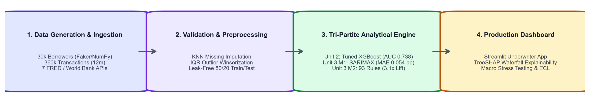
*Figure 1. End-to-end IntelliCredit pipeline from data generation to the dashboard.*

## Table of Contents

- 1. Introduction, Business Objectives and Literature Review
- 2. Dataset Collection, Validation and Preparation
- 3. Exploratory Data Analysis and Visualisation
- 4. Feature Engineering and Predictive Modelling
- 5. Advanced Analytics
- 6. Comparative Analysis and Business Impact
- 7. Interactive Application and Reproducibility
- 8. End-to-End Validation, Traceability and Contributions
- 9. Conclusion, Recommendations and Roadmap
- References
- Appendices

## List of Figures

- **Figure 1:** IntelliCredit pipeline architecture
- **Figure 2:** Synthetic and UCI shape validation distributions
- **Figure 3:** Synthetic feature correlation matrix
- **Figure 4:** UCI feature correlation matrix
- **Figure 5:** Exploratory borrower patterns
- **Figure 6:** Additional behaviour and default comparisons
- **Figure 7:** Predictive model comparison
- **Figure 8:** Historical portfolio default-rate trend
- **Figure 9:** Portfolio stress scenarios
- **Figure 10:** Association-rule support, confidence and lift
- **Figure 11:** Underwriter dashboard
- **Figure 12:** Portfolio dashboard
- **Figure 13:** AUC transfer comparison
- **Figure 14:** Calibration plots
- **Figure 15:** Distance-to-closest-record plot

## List of Tables

- **Table 1:** Project objectives and success measures
- **Table 2:** Main datasets
- **Table 3:** Representative final-data sample
- **Table 4:** Data quality, privacy and ethics checks
- **Table 5:** Final field mapping across Units 1–3
- **Table 6:** Project model results
- **Table 7:** Comparison with FinXCredit
- **Table 8:** KPI-based business scenarios
- **Table 9:** Objective-to-evidence traceability matrix
- **Table 10:** Pipeline validation results
- **Table 11:** Figure index and reproduction map
- **Table 12:** Individual contribution records

## Abbreviations

**AUC:** Area Under the Curve; **ARM:** Association Rule Mining; **BNPL:** Buy Now, Pay Later; **DCR:** Distance to Closest Record; **ECL:** Expected Credit Loss; **FRED:** Federal Reserve Economic Data; **MAE:** Mean Absolute Error; **PD:** Probability of Default; **PR-AUC:** Precision-Recall Area Under Curve; **SARIMAX:** Seasonal ARIMA with external variables; **SHAP:** SHapley Additive exPlanations; **TSTR:** Train on Synthetic, Test on Real; **TRTS:** Train on Real, Test on Synthetic; **UCI:** University of California, Irvine.

## 1. Introduction, Business Objectives and Literature Review

### 1.1 Context and scope

Traditional credit scoring normally looks at credit-card history, salary slips and previous loans. A gig worker may earn money every month but still not have these documents. This creates a problem for both sides. The worker may be rejected unfairly, while the lender has less information to judge the loan.

IntelliCredit studies alternative signals such as monthly income, income changes, utility payment delays, BNPL amount, savings buffer, UPI activity and gig-work tenure. The project is not meant to make a final legal lending decision. It is a learning project that shows how different analytics methods can work together.

| Objective | Measure | Target or check |
|---|---|---|
| Understand borrower risk | EDA plots and tests | Clear patterns and no hidden data errors |
| Predict individual default | ROC-AUC, PR-AUC and calibration | Better than a random model and checked on held-out data |
| Find groups of warning signs | Support, confidence and lift | Rules must also work on unseen borrowers |
| Forecast portfolio risk | MAE and MAPE | Compare SARIMAX with simpler baselines |
| Check whether the pipeline is realistic | TSTR/TRTS, KS, Wasserstein and DCR | Report both good results and mismatches |

*Table 1. Project objectives and success measures.*

### 1.2 Related paper and research gap

The main paper used for comparison is **FinXCredit: An AI-Powered Alternative Credit Risk Assessment System for India's Gig Economy Workers** by Vikrant Chauhan, Mangesh Sawarkar, Jivesh Nage, Poonam Mishra and Goldi Soni [1]. It was published in IJSREM in May 2026.

The paper describes a large synthetic dataset with more than 100,000 records. It uses an XGBoost model, a five-factor scoring engine and SHAP explanations. It also describes a full web system with KYC, login, OCR and a database. The paper reports an accuracy of 78.6% and ROC-AUC of 0.85 on its own hold-out data.

The paper is useful because it shows that transaction activity and income behaviour can help with gig-worker credit scoring. Gradient-boosted models are also common in credit-scoring benchmarks [2], while SHAP is a standard way to explain model outputs [3]. Our project is similar in its use of alternative data, synthetic data and explainable machine learning. The main difference is that IntelliCredit focuses more on the **full analytics pipeline**: it adds portfolio forecasting, association rules, external macroeconomic data and a separate validation experiment against UCI data.

The comparison must be read carefully. The two projects use different data, labels, feature definitions and test splits. Therefore, their AUC values cannot be treated as a direct competition. A high score on one synthetic dataset does not automatically mean that the model will work on another dataset.

## 2. Dataset Collection, Validation and Preparation

### 2.1 Provenance, coverage and challenges

| Dataset | Rows | Description | Use |
|---|---:|---|---|
| `borrower_profiles.csv` | 30,000 | Synthetic borrower records | EDA and default modelling |
| `monthly_transactions.csv` | 360,000 | Twelve months of behaviour per borrower | Features and EDA |
| `macro_india_monthly.csv` | 108 | FRED and World Bank monthly indicators | Forecasting |
| `portfolio_monthly.csv` | 72 | Simulated monthly loan-portfolio history | Forecasting |
| `train.csv` | 24,000 | Stratified training records | Model training and ARM |
| `test.csv` | 6,000 | Held-out records | Final project evaluation |
| `data_compare/UCI_Credit_Card.csv` | 30,000 | Public real-world credit-card benchmark | Pipeline comparison |

*Table 2. Main datasets used by IntelliCredit and their analytical roles.*

The borrower records were generated with Python using fixed seeds. The generator links income, payment behaviour and default risk instead of making every column independent. This makes the data useful for learning, but it also means that some relationships are designed into the simulation.

The primary borrower and transaction data was generated on 9 November 2026 with NumPy, Faker and the project scripts. The project dataset is not copied from Kaggle, GitHub or UCI. The UCI file is used only in the later validation experiment as an external benchmark. The synthetic data has 39 borrower-level fields and 15 transaction-level fields. The target is `loan_default_status`, a binary indicator for default or 90-day delinquency.

The synthetic generator uses a log-normal income distribution, conditional payment behaviour, bounded loan features, and a logistic default link. The main seeds are 42 for borrower data and machine learning and 2026 for portfolio simulation. API responses are cached so the macro pipeline can also run offline.

| Sample row | Age | Income (₹) | Utility reliability | Debt/inflow | Default |
|---|---:|---:|---:|---:|---:|
| BRW-000001 | 31 | 26,450 | 0.92 | 0.14 | 0 |
| BRW-000002 | 39 | 18,900 | 0.67 | 0.31 | 1 |
| BRW-000003 | 28 | 34,120 | 1.00 | 0.08 | 0 |
| BRW-000004 | 45 | 22,700 | 0.75 | 0.27 | 0 |
| BRW-000005 | 26 | 15,400 | 0.58 | 0.39 | 1 |

*Table 3. Representative final-data sample. The identifiers are synthetic and are included only to show the data shape.*

Collection challenges included missing macro observations, different frequencies between annual World Bank indicators and monthly FRED series, and the lack of gig-worker features in the UCI benchmark. The project addresses these with cached fallbacks, documented monthly interpolation in `src/macro_api.py`, and an explicit feature crosswalk rather than pretending that the fields are identical.

### 2.2 Data quality, privacy and ethics

The cleaning pipeline checks missing values, invalid categories, outliers, date alignment and target leakage. Structural nulls, such as a missing default month for a loan that never defaulted, are kept because they have a valid meaning. The project does not use real borrower names or private account data.

The project also records a correction for a date bug. Earlier code used a 30-day time step, which could create duplicate month labels. It was changed to `pd.date_range(..., freq="MS")`, which gives correct calendar months.

| Check | Finding | Action and final status |
|---|---|---|
| Missing values | Portfolio default months are structurally null for non-defaulted loans | Retained with documented meaning |
| Duplicate months | Earlier 30-day increment caused month collisions | Replaced with calendar-month dates |
| Invalid categories | Possible unmapped ordinal values | Centralised maps and assertions |
| Class imbalance | Default rate is about 7.87% | Use PR-AUC, recall and calibration, not accuracy alone |
| Leakage | SMOTE before cross-validation was identified as unsafe | SMOTE moved inside the training pipeline |
| Privacy | No real borrower PII is stored | Synthetic names and IDs only |

*Table 4. Data quality, privacy and ethics checks.*

The project has no consent requirement for real borrowers because the primary records are synthetic. If real data is added later, the team would need documented authorization, purpose limitation, access control, retention rules and compliance review under India's Digital Personal Data Protection Act, 2023. The main representation bias is that the synthetic population is designed around gig workers and may not represent salaried borrowers, older borrowers or every Indian region. The UCI mapping also uses imputed constants for fields that do not exist in that dataset.

### 2.3 Transformations and usable dataset

The raw files are checked and transformed before analysis. Numeric missing values use median or KNN-style imputation where appropriate; categorical values use mode or explicit ordinal maps; extreme values are winsorised using IQR limits; dates are converted to monthly timestamps; and transaction rows are aggregated to borrower-level features. Model scaling, encoding and SMOTE are model-specific and are fitted only on training folds.

| Transformation | Before | After | Reason |
|---|---:|---:|---|
| Borrower records | 30,000 raw | 30,000 usable | No rows removed for normal synthetic values |
| Monthly transactions | 360,000 raw | 360,000 usable | Aggregated by borrower and month |
| Train/test split | 30,000 | 24,000 / 6,000 | Stratified 80/20 split |
| ARM data | 24,000 borrowers | 19 binary behaviour flags | Makes itemsets comparable |
| Portfolio data | 250,191 loan-month rows | 72 monthly portfolio rows | Aggregate for forecasting |

The final field mapping is:

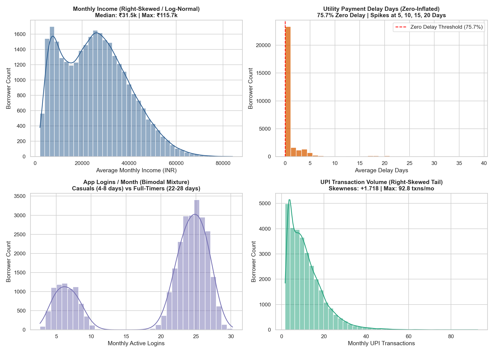
*Figure 2. Shape validation distributions. Tool: Python/Matplotlib; source: `validation/step4_fidelity_audit.py`.*

The validation plots help us see whether the generated data looks reasonable and whether it is too close to the comparison data.

The plots show that some features are reasonably close, especially age and the income proxy. Other features are clearly different. For example, utility reliability is much higher in the synthetic data, while the UCI data has more payment delay behaviour. This does not make the project data useless, but it means that transfer results must be reported honestly.

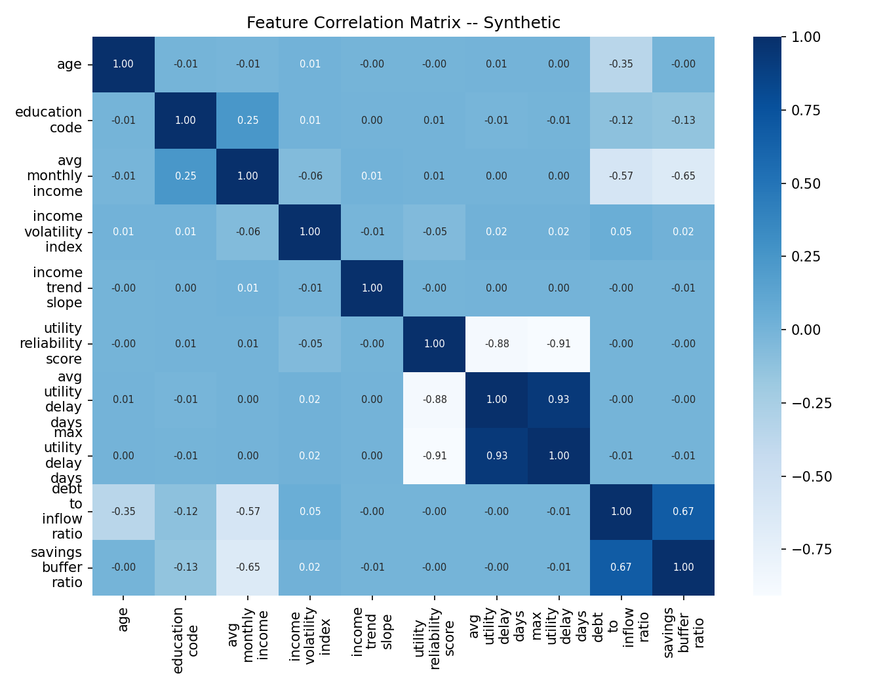
*Figure 3. Correlation structure in the synthetic data.*

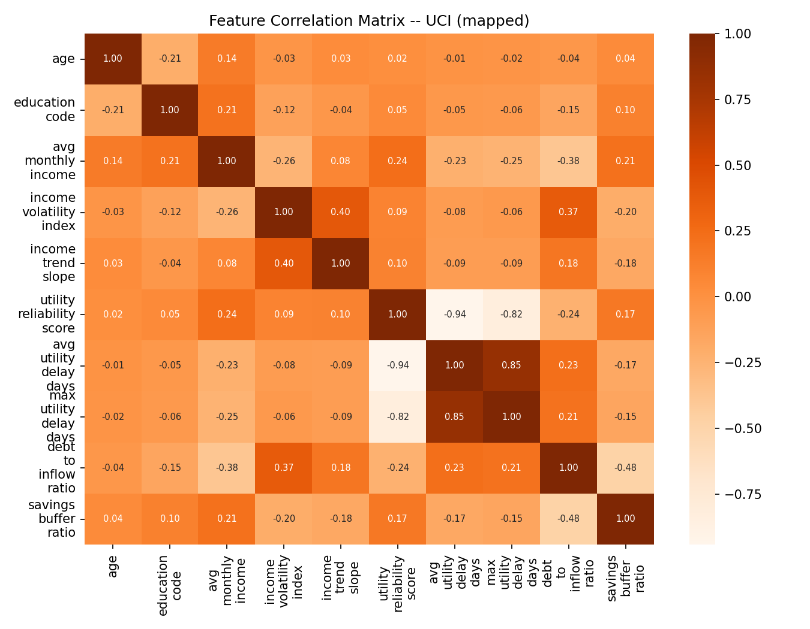
*Figure 4. Correlation structure in the mapped UCI data.*

The two correlation plots also look different. The correlation-matrix Frobenius distance is 2.5595. This supports the conclusion that the two datasets are not the same type of population.

| Field or group | Preparation | Used in |
|---|---|---|
| Income and transaction values | Cleaning, winsorisation and aggregation | EDA, ML, ARM |
| Utility payment fields | Reliability and delay features | EDA, ML, ARM |
| Gig tenure | Numeric and grouped versions | EDA, ML, ARM |
| Loan default status | Kept as target only | ML and ARM validation |
| Portfolio monthly data | Monthly default-rate series | SARIMAX |
| Macro indicators | API collection and cached fallback | SARIMAX |
| UCI credit-card fields | Feature crosswalk to project schema | Pipeline validation |

*Table 5. Final field mapping across Units 1–3.*

## 3. Exploratory Data Analysis and Visualisation

EDA was used before modelling so that we could understand the data instead of treating the model as a black box. The notebooks check distributions, groups, correlations and default rates.

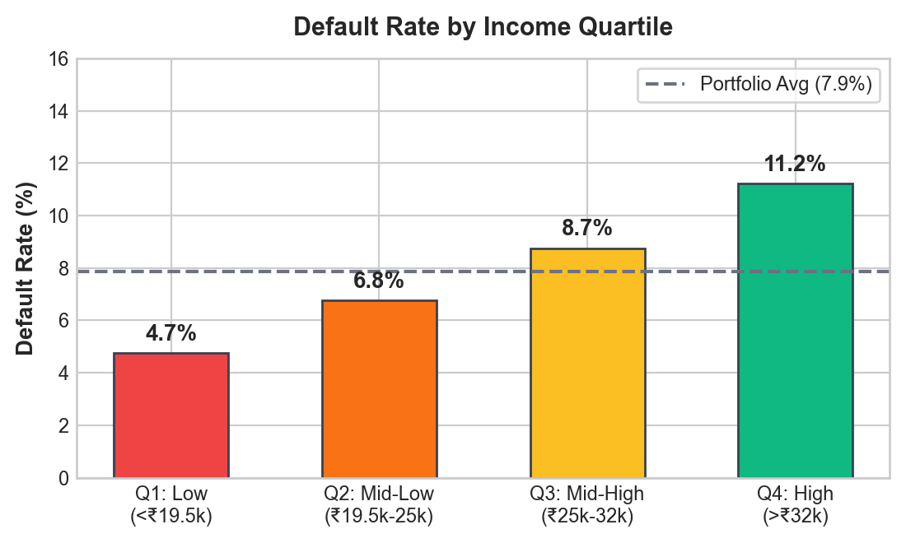
*Figure 5. Exploratory borrower patterns from the project data.*

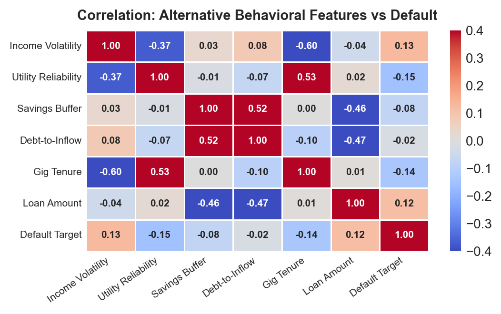
*Figure 6. Additional behaviour and default comparisons.*

The main patterns were:

- Borrowers with short gig-work tenure generally show higher default risk.
- Higher income volatility is linked with more defaults.
- Utility payment delays are a useful warning signal.
- A larger debt-to-income ratio is linked with higher risk.
- The default class is smaller than the non-default class, so accuracy alone is not a good measure.

The project uses ROC-AUC and PR-AUC together with recall and calibration. This is important because a model can get high accuracy by predicting “no default” for almost everyone.

### 3.1 Important findings and hypotheses

The EDA supports four hypotheses. First, shorter gig tenure is associated with more defaults because the income history is less stable. Second, high income volatility is associated with lower repayment ability. Third, utility delays and BNPL burden can work as early warning signals. Fourth, macroeconomic stress can increase portfolio defaults even when individual borrower features stay the same. Mann–Whitney and chi-square tests in the EDA notebook are used as evidence for group differences, but they are interpreted as associations and not causal effects.

## 4. Feature Engineering and Predictive Modelling

### 4.1 Predictors, target and feature construction

The project creates features such as income volatility, income trend, utility reliability, savings buffer, debt-to-inflow ratio, loan-to-income ratio and repayment ratio. These features are easier to understand than a long list of raw monthly columns.

The target is `loan_default_status`. Predictors are borrower demographics, aggregated transactions, loan request information and derived financial ratios. VIF, mutual information, RFE and WoE/IV checks are used to remove unhelpful or highly repeated signals. PCA and t-SNE are used for understanding structure, not as the only basis for a lending decision.

### 4.2 Model development and leakage audit

The data is split into 80% training and 20% testing. SMOTE and other preprocessing steps are placed inside the training pipeline so that the test set is not used to create synthetic training examples. This is one of the most important leakage checks in the project.

Five-fold cross-validation is used inside the training data for tuning. The held-out 6,000 borrowers are used once for final comparison. The leakage audit checks that the target is excluded, entity rows do not cross the split, scalers and imputers are fitted within folds, and SMOTE is not run before the folds are created.

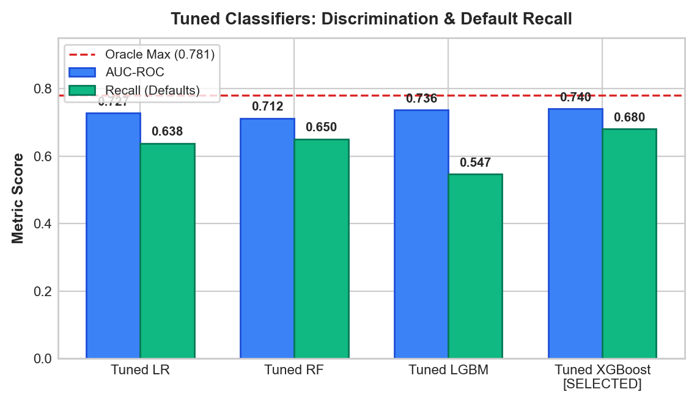
*Figure 7. Model comparison on the project evaluation data.*

| Model | Test ROC-AUC | Test PR-AUC | Recall |
|---|---:|---:|---:|
| Logistic Regression | 0.728 | 0.197 | 0.638 |
| Random Forest | 0.713 | 0.178 | 0.663 |
| XGBoost, tuned | 0.738 | 0.204 | 0.682 |
| LightGBM, tuned | 0.735 | 0.201 | 0.614 |
| Calibrated LightGBM | 0.741 | 0.199 | Checked with calibration |

*Table 6. Project model results on the held-out synthetic test set.*

The simple logistic model is the baseline. The tuned tree models are the proposed alternatives, and calibrated LightGBM is the dashboard choice because its output is intended to be read as a probability.

The calibrated LightGBM model was selected for the dashboard because it gives probabilities that can be used in a break-even decision rule. XGBoost is also useful for ranking applicants. SHAP explanations show the main reasons for a prediction, such as gig tenure, income trend, utility reliability and income volatility.

These results are good for the project data, but they are not proof that the model is ready for a bank. The external validation in Section 8 gives a more cautious picture.

### 4.3 Interpretation, error analysis and subgroup limitations

SHAP is used to explain which features push a prediction higher or lower. The strongest project signals are gig tenure, income trend, utility reliability, loan-to-income ratio and income volatility. These explanations are useful for a reviewer, but SHAP shows association with the model output; it does not prove that changing a feature would change a borrower's real risk.

The model is less reliable for early-tenure and rural-style profiles because those groups have fewer stable signals in the synthetic data. This is why the recommended policy uses manual review and does not treat the probability score as an automatic approval or rejection. A future real-data study should report subgroup AUC, recall, false-negative rate and approval rate using actual outcomes.

## 5. Advanced Analytics

### 5.1 Method 1: Time-series forecasting

The first advanced method asks: **when might portfolio defaults rise?**

The project uses 72 months of simulated portfolio data and macroeconomic indicators such as inflation, unemployment, interest rates, GDP growth and exchange rate. SARIMAX was compared with seasonal naive, SARIMA, Holt-Winters and gradient boosting.

The SARIMAX model gave a 2024 hold-out MAE of 0.054 percentage points and MAPE of about 16%. The macro variables help the model react to conditions that are not visible in the past default-rate series alone. The result is a forecast, not a guarantee.

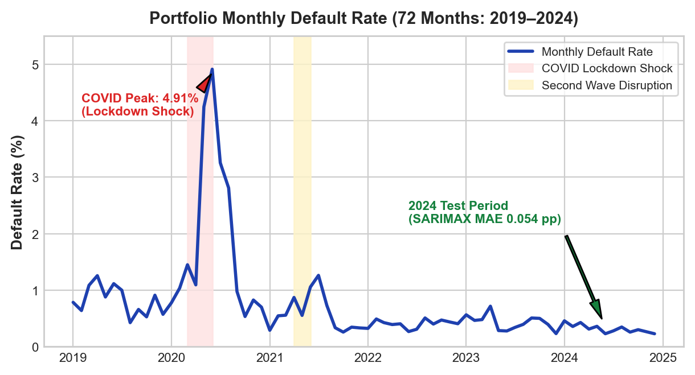
*Figure 8. Historical portfolio default-rate trend and modelled time-series behaviour. Tool: Python/Matplotlib; source: `notebooks/06_R2_M1_time_series_forecasting.ipynb`.*

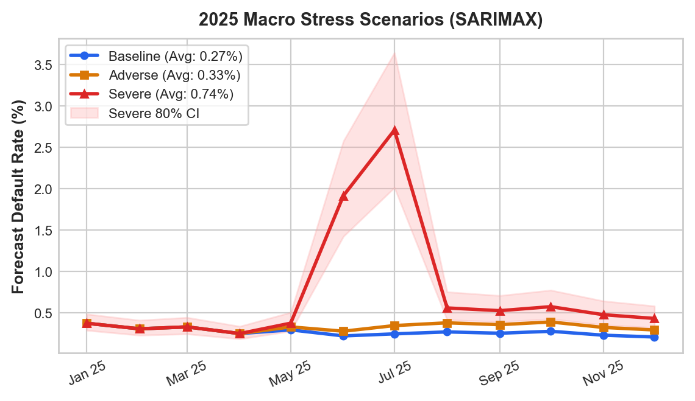
*Figure 9. Baseline, adverse and severe portfolio scenarios. Tool: Python/Matplotlib; source: `models/ts_forecast_scenarios.csv`.*

### 5.2 Method 2: Association rule mining

The second method asks: **which warning signs appear together?**

Nineteen behaviour flags were converted into itemsets. Apriori and FP-Growth produced frequent itemsets. Rules were then filtered using support, lift, statistical testing and redundancy checks. The final project output contains 93 warning rules. They were checked on the held-out borrowers, and the project reports that all 93 kept test lift above 1.3.

This method is useful because it gives simple statements such as “declining income + volatile income + low savings buffer is a risky combination.” It does not replace the ML score; it gives an extra explanation for a manual reviewer.

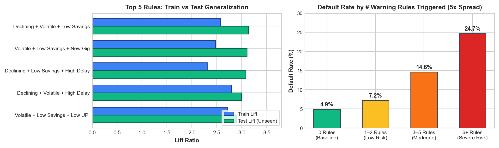
*Figure 10. Association-rule support, confidence and lift. Tool: Python/Matplotlib; source: `notebooks/07_R2_M2_association_rule_mining.ipynb`.*

The main limitations are that frequent patterns are not automatically causal, and rules can change when the population or threshold definitions change. The test-set lift check reduces this risk, but it does not remove it completely.

## 6. Comparative Analysis and Business Impact

### 6.1 Comparing the two advanced methods

Time-series forecasting works at the portfolio level. It helps answer how the whole book may change during an economic shock. Association rules work at the borrower level. They help explain combinations of warning signs.

The methods do not use the same metric and should not be ranked against each other. Their value is that they answer different questions and can be shown together in the dashboard.

### 6.2 Comparison with FinXCredit

| Topic | FinXCredit paper | IntelliCredit |
|---|---|---|
| Main problem | Credit scoring for Indian gig workers | Credit scoring plus portfolio risk |
| Main data | More than 100,000 synthetic records | 30,000 borrower profiles and 360,000 transactions |
| Main model | XGBoost and five-factor heuristic | Logistic Regression, RF, XGBoost, LightGBM and calibrated model |
| Explainability | SHAP | SHAP plus human-readable warning rules |
| Macro forecasting | Not a main part of the paper | SARIMAX with FRED and World Bank data |
| Application | FastAPI, React, KYC and login features | Streamlit research dashboard |
| External pipeline test | Reported hold-out test | UCI crosswalk, TSTR/TRTS, KS, Wasserstein and DCR |
| Main caution | Synthetic-data results | Strong synthetic-to-UCI mismatch is reported |

*Table 7. Comparison with the reference paper. Numerical AUC values are not directly comparable because the datasets and testing setups differ.*

The FinXCredit paper is stronger in product features such as authentication and KYC. IntelliCredit is stronger in combining several analytics methods and showing a separate pipeline validation. Neither project should claim production readiness without testing on real approved-loan records.

### 6.3 Business impact and scenarios

The dashboard can use a break-even probability rule. In the project scenario, a normal portfolio has an estimated expected credit loss of about ₹1.59 crore. An adverse scenario increases this by about ₹36 lakh, while a severe scenario increases it by about ₹2.74 crore. These are modelled scenarios, not measured future losses.

The practical use is to help a lender decide when to:

- send more applications to manual review;
- reduce loan size for unstable income;
- keep extra loss reserves during a stress period; and
- explain why an application needs more information.

| Scenario | Assumption | Estimated result | Type |
|---|---|---:|---|
| Best / baseline | Normal macro conditions | ₹1.59 crore ECL | Modelled scenario |
| Adverse | Unemployment +1.5 pp and GDP decline | ₹1.95 crore ECL | Modelled scenario |
| Severe | COVID-style stress multiplier | ₹4.32 crore ECL | Stress scenario |

*Table 8. KPI-based business scenarios. These are modelled estimates, not measured future losses.*

These estimates depend on the simulated portfolio size, loss assumptions and macro overlay. The operational cost is mainly manual-review time, data access and model monitoring. The expected benefit is lower exposure to poorly understood risk, but it should be measured in a real pilot rather than assumed.

## 7. Interactive Application, Figure Index and Reproducibility

### 7.1 Mandatory dashboard or website

The Streamlit dashboard has tabs for borrower underwriting, portfolio trends, warning rules, dataset exploration and combined insights. It reads the saved model, portfolio outputs and rule tables. Some outputs are precomputed, while the applicant score and filters are calculated when the user interacts with the dashboard.

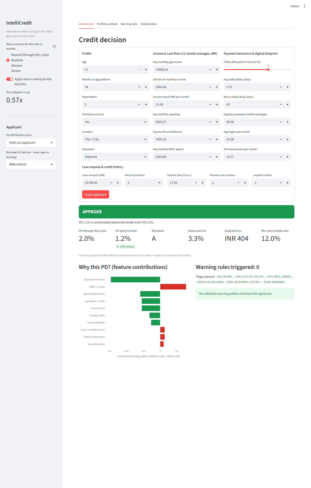
*Figure 11. Underwriter dashboard view with a borrower risk result.*

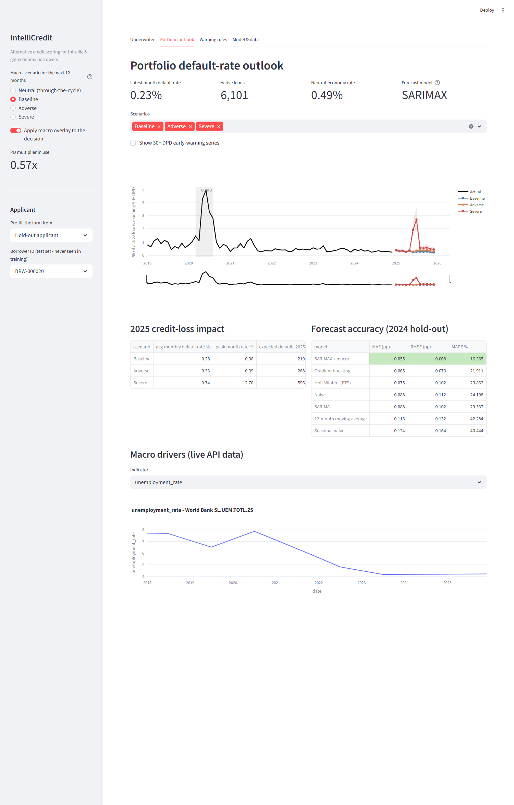
*Figure 12. Portfolio view for trend and scenario analysis.*

To reproduce the project:

```bash
python -m venv venv
pip install -r requirements.txt
python data_generation.py
python -m src.macro_api --offline
python -m src.portfolio_simulation
python -m src.underwriting_model
python validation/run_all.py
streamlit run dashboard/app.py
```

The repository includes notebooks, source code, data dictionaries, model files, reports and validation outputs. The fixed random seeds make the main experiments repeatable.

The dashboard was checked by loading the application, opening each tab, scoring a sample borrower, changing portfolio filters and viewing the warning-rule table. Known limitations are that it depends on the saved model files, the macro API may be unavailable offline, and it is a research prototype rather than a secure production service.

### 7.2 Figure index and reproduction map

Figures are embedded once in the analytical sections. This index gives the source and purpose without repeating the images.

| Figure | Title / tool | Section and purpose | Source |
|---|---|---|---|
| 1 | Pipeline architecture / Python | Workflow connecting Units 1–3 and dashboard | `reports/presentation_figures/pipeline_architecture.png` |
| 2 | Shape distributions / Python | Synthetic versus UCI feature shapes | `validation/step4_fidelity_audit.py` |
| 3–4 | Correlation matrices / Seaborn | Relationship structure comparison | `validation/results/fidelity_corr_*.png` |
| 5–6 | EDA charts / Matplotlib | Behaviour and default patterns | `notebooks/02_M2_exploratory_data_analysis.ipynb` |
| 7 | Model comparison / Matplotlib | Held-out model metrics | `notebooks/04_M4_predictive_modeling.ipynb` |
| 8–9 | Forecast and scenarios / Matplotlib | Portfolio trend and ECL stress | `notebooks/06_R2_M1_time_series_forecasting.ipynb` |
| 10 | Association rules / Matplotlib | Support, confidence and lift | `notebooks/07_R2_M2_association_rule_mining.ipynb` |
| 11–15 | Dashboard and validation plots | Application and transfer checks | `dashboard/app.py`, `validation/results/` |

*Table 11. Figure index and reproduction map.*

### 7.3 Code and environment

The repository is `https://github.com/Darun1017/intellicredit-report`. It contains `data/`, `data_compare/`, `data/processed/`, `notebooks/`, `src/`, `models/`, `validation/`, `dashboard/`, `reports/` and `requirements.txt`. Python 3.10+ is recommended. The requirements file lists the analytics, machine-learning, visualization and Streamlit packages.

The project uses only synthetic borrower data for its main analysis. The UCI file is retained as a validation reference, with its source and mapping documented in `validation/step1_feature_crosswalk.py`. No secrets are stored in the repository. Macro API data is cached and may be regenerated with the offline fallback.

## 8. End-to-End Validation, Traceability and Contributions

### 8.1 Completion and validity

The declared scope is complete: Unit 1 covers cleaning and EDA; Unit 2 covers feature engineering and predictive modelling; Unit 3 covers SARIMAX and association rules; and the Streamlit dashboard connects the outputs. The main threats to validity are synthetic-data circularity, mismatch between synthetic and UCI populations, imputed fields in the crosswalk, and the lack of real lending outcomes.

| Objective / KPI | Analysis or method | Result / metric | Evidence | Recommendation |
|---|---|---:|---|---|
| Understand borrower risk | EDA and plots | Behavioural differences identified | Figures 5–6; Notebook 02 | Use behaviour as supporting evidence |
| Predict default | ML with held-out test | Calibrated LightGBM AUC 0.741 | Figure 7; Notebook 05 | Recalibrate on approved real data |
| Find warning combinations | Apriori / FP-Growth | 93 rules; test lift ≥ 1.3 | Figure 10; Notebook 07 | Use as manual-review signals |
| Forecast portfolio risk | SARIMAX | MAE 0.054 pp | Figures 8–9; Notebook 06 | Monitor macro stress |
| Validate transfer | TSTR/TRTS and fidelity | TSTR AUC 0.5941; gap 0.2827 | Figures 13–15; `validation/` | Do not deploy without real-data testing |

*Table 9. Objective-to-evidence traceability matrix.*

### 8.2 Project tracking and individual work

The project was tracked through GitHub Issues and Projects using five stages: **Backlog, To Do, In Progress, Review/Testing and Completed**. The repository issue history and the project-management file record the task sequence from data generation to dashboard and final report. The board reference is documented in `GITHUB_BOARD_SETUP.md`; the task evidence is in `reports/project_management_and_contributions.md`.

| Team member | Assigned work | Evidence |
|---|---|---|
| Darun R G | Data generation, feature engineering, ARM preparation and validation | `data_generation.py`, notebooks 01/03, `data/DATASET_VALIDATION_SUMMARY.md` |
| goldmauler | Model tuning, SARIMAX, association rules and synthesis | notebooks 04/06/07/08, `models/` |
| Abhinav Juturu | EDA, statistical tests and portfolio simulation | notebook 02, `src/portfolio_simulation.py` |
| Gowtham Reddy | Cleaning, Streamlit dashboard and HTML report | notebook 01, `dashboard/app.py`, `reports/interactive_dashboard.html` |
| Adithya | Model evaluation, SHAP, recommendations and reporting | notebook 05, `reports/` |

Individual marks can differ according to participation and ability to explain the work. Commit and issue history provide additional evidence.

*Table 12. Individual contribution records.*

### 8.3 AI use and originality declarations

Generative AI was used for code suggestions, debugging, plain-language editing and report formatting. The team decided the data-generating process, features, experiments, validation tests and conclusions. Team members ran the code and corrected errors. In particular, the transfer failure was kept in the report instead of being hidden.

The report uses cited ideas, algorithms, software and external sources. No copied personal data or restricted borrower records are included. A Turnitin similarity report should be attached by the team before submission and should meet the course target of 15% or below; this repository does not contain a generated similarity percentage.

### 8.4 Pipeline validation using `data_compare` and `validation`

The `data_compare` folder contains the UCI Credit Card Default data used as a real-world comparison. The `validation` folder runs four steps:

1. **Feature crosswalk:** maps UCI columns into the IntelliCredit feature format.
2. **TSTR/TRTS experiments:** trains on one data source and tests on the other.
3. **Calibration and policy check:** checks probability reliability and break-even decisions.
4. **Fidelity audit:** compares distributions, correlations and record distances.

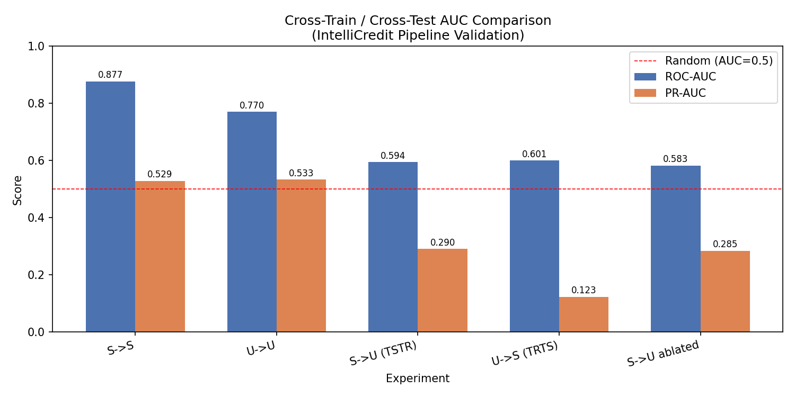
*Figure 13. AUC results for same-domain and cross-domain experiments.*

| Experiment | AUC | PR-AUC | Meaning |
|---|---:|---:|---|
| Synthetic → Synthetic | 0.8768 | 0.5290 | Strong same-domain result |
| UCI → UCI | 0.7700 | 0.5330 | Real-data benchmark result |
| Synthetic → UCI (TSTR) | 0.5941 | 0.2904 | Weak transfer to mapped real data |
| UCI → Synthetic (TRTS) | 0.6005 | 0.1234 | Weak reverse transfer |

*Table 10. Pipeline validation results from `validation/results/run_summary.txt`.*

The synthetic-to-UCI AUC gap is 0.2827, labelled “strong domain mismatch” by the validation script. This is the most important limitation in the report. It tells us that the project model learns patterns that do not fully match the mapped UCI population.

### 8.5 Calibration, policy and fidelity checks

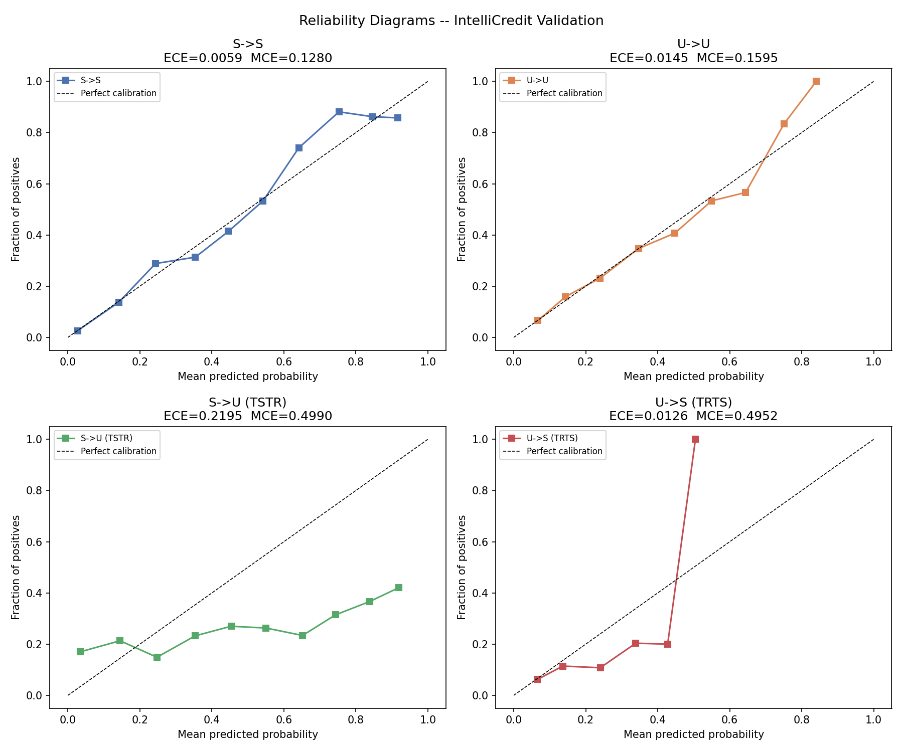
*Figure 14. Reliability diagrams for the transfer experiments.*

The same-domain synthetic result has a low ECE of 0.00594, but the TSTR result has a much higher ECE of 0.21952. This means the probability values are not reliable when moved directly to the UCI population.

The fidelity audit found:

- age and the income proxy were relatively close;
- education, utility reliability, savings buffer and debt-to-inflow ratio had high KS warnings;
- correlation matrices were different;
- DCR mean was 0.4864 and the fifth percentile was 0.2497, so the privacy proxy did not show near-copying.

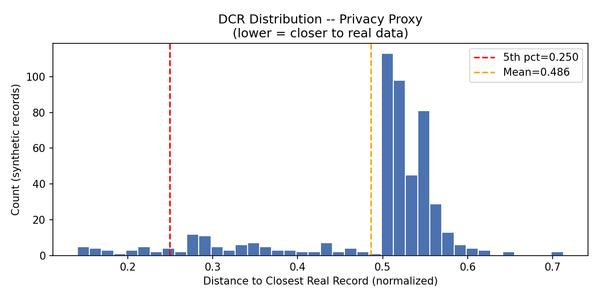
*Figure 15. Distance-to-closest-record plot used as a privacy proxy.*

These checks make the report more honest. They show both what worked and what still needs improvement.

## 9. Conclusion, Recommendations and Roadmap

IntelliCredit shows how a credit-risk project can combine individual prediction, warning rules and portfolio forecasting. On its own synthetic test set, the model performs well enough to demonstrate the idea. The dashboard makes the results easier to inspect.

The strongest lesson is that validation matters as much as model accuracy. The `data_compare` and `validation` outputs show a large gap when the synthetic model is moved to UCI data. Because of this, the project should be used for education and research, not automatic lending.

### Recommended next steps

1. Collect an approved, anonymised real loan dataset with the same feature meanings.
2. Rebuild the feature crosswalk using real gig-worker transaction fields rather than imputed constants.
3. Calibrate the model separately for different borrower groups and time periods.
4. Add fairness checks using real outcomes and clear consent.
5. Compare model decisions with human review and measure approval quality, not only AUC.

| Time | Action | Responsible stakeholder | Success check |
|---|---|---|---|
| Immediate | Freeze the current research prototype and document its limits | Project team | Reproducible validation run |
| Medium term | Collect consented, anonymised real lending outcomes | Lender and data team | Real-data calibration and subgroup report |
| Longer term | Pilot human-in-the-loop underwriting and monitoring | Risk and compliance team | Approval quality, default rate and fairness review |

The current scope does not include real borrower consent, production security, live lending decisions or a causal impact study. These are future enhancements, not completed features.

## References

1. Chauhan, V., Sawarkar, M., Nage, J., Mishra, P. and Soni, G. (2026). *FinXCredit: An AI-Powered Alternative Credit Risk Assessment System for India's Gig Economy Workers*. International Journal of Scientific Research in Engineering and Management, 10(5). DOI: 10.55041/IJSREM62883.
2. Lessmann, S., Baesens, B., Seow, H.-V. and Thomas, L. (2015). Benchmarking state-of-the-art classification algorithms for credit scoring. *European Journal of Operational Research*, 247(1), 124–136.
3. Lundberg, S. and Lee, S.-I. (2017). A unified approach to interpreting model predictions. *NeurIPS*.
4. Chen, T. and Guestrin, C. (2016). XGBoost: A scalable tree boosting system. *KDD*.
5. Federal Reserve Bank of St. Louis. FRED economic data series used by the project.
6. World Bank. World Development Indicators used by the project.
7. Yeh, I.-C. and Lien, C.-H. (2009). The comparisons of data mining techniques for the predictive accuracy of probability of default of credit card clients. *Expert Systems with Applications*, 36(2), 2473–2480.

## Appendix A. Extended Data Dictionary and Validation Records

| Purpose | Files |
|---|---|
| Data generation | `data_generation.py`, `data/data_dictionary.txt` |
| Cleaning and EDA | `notebooks/01_M1_data_cleaning_preprocessing.ipynb`, `notebooks/02_M2_exploratory_data_analysis.ipynb` |
| Feature and model work | `notebooks/03_M3_feature_engineering.ipynb` to `05_M5_evaluation_interpretation.ipynb` |
| Forecasting | `notebooks/06_R2_M1_time_series_forecasting.ipynb` |
| Association rules | `notebooks/07_R2_M2_association_rule_mining.ipynb` |
| Dashboard | `dashboard/app.py` |
| External comparison | `data_compare/UCI_Credit_Card.csv` |
| Validation scripts | `validation/step1_feature_crosswalk.py` to `validation/step4_fidelity_audit.py` |

The extended data dictionary is stored in `data/data_dictionary.txt`. It defines borrower, transaction, macro, engineered and target fields. The validation record is stored in `validation/results/run_summary.txt`, `experiment_results.json`, `fidelity_summary.json` and `fidelity_ks_wasserstein.csv`. These files contain the numeric results behind the tables and plots in Sections 2 and 8.

## Appendix B. Additional Figures, Supplementary Analysis and Tuning

The supplementary figures include `validation_figures/ks_comparison.png`, `validation_figures/policy_comparison.png`, `validation_figures/fidelity_corr_synth.png`, `validation_figures/fidelity_corr_uci.png` and `validation_figures/calibration_tstr.png`. The model tuning notebooks record the candidate algorithms, cross-validation process, SMOTE placement and final comparison.

| Model family | Main settings or check | Purpose |
|---|---|---|
| Logistic Regression | Tuned regularisation | Interpretable baseline |
| Random Forest | Tuned tree count and depth | Non-linear baseline |
| XGBoost | Tuned boosting and learning rate | Ranking comparison |
| LightGBM | Calibrated probability output | Dashboard decision support |
| SARIMAX | Seasonal order with macro exogenous variables | Portfolio forecast |
| Apriori / FP-Growth | Support, lift, Fisher filtering | Warning-rule discovery |

Error analysis is reported through recall, PR-AUC, calibration, transfer AUC, KS distance and policy default rates. This avoids relying only on one headline metric.

## Appendix C. Implementation Details and Dashboard User Guide

### C.1 Installation and commands

```bash
python -m venv venv
pip install -r requirements.txt
python data_generation.py
python -m src.macro_api --offline
python -m src.portfolio_simulation
python -m src.underwriting_model
python validation/run_all.py
streamlit run dashboard/app.py
```

### C.2 Dashboard user guide

1. Open the **Underwriter** tab and enter or select borrower features.
2. Read the probability of default, decision threshold and SHAP reasons.
3. Use **Portfolio** to inspect historical default rates and stress scenarios.
4. Use **Warning Rules** to see behavioural combinations and lift.
5. Use **Dataset Explorer** to filter records and check distributions.
6. Use **Combined Insights** to compare borrower PD, rule counts and macro overlays.

The saved model, rule table and portfolio files are loaded from the repository. The dashboard should not be connected to real personal information without security, consent and access controls.

### C.3 Configuration and sample outputs

Shared paths, ordinal maps and random seeds are in `src/config.py`. Sample data is available in `data/sample/` and `data/sample_final_dataset.csv`. Example dashboard screenshots are in `reports/screenshots/`.

## Appendix D. Tracking Board, Contributions, AI Declaration and Similarity

The project tracking evidence is in `GITHUB_BOARD_SETUP.md` and `reports/project_management_and_contributions.md`. The planned board stages are Backlog, To Do, In Progress, Review/Testing and Completed. The task history includes data generation, cleaning, EDA, modelling, forecasting, association rules, dashboard work, validation and report preparation.

| Team member | Contribution record | Evidence |
|---|---|---|
| Darun R G | Data architecture, synthetic generator, feature engineering and validation | `data_generation.py`, `notebooks/03_M3_feature_engineering.ipynb`, `data/DATASET_VALIDATION_SUMMARY.md` |
| goldmauler | Predictive modelling, SARIMAX and association rules | `notebooks/04_M4_predictive_modeling.ipynb`, `notebooks/06_R2_M1_time_series_forecasting.ipynb`, `notebooks/07_R2_M2_association_rule_mining.ipynb` |
| Abhinav Juturu | EDA, hypothesis tests and portfolio simulation | `notebooks/02_M2_exploratory_data_analysis.ipynb`, `src/portfolio_simulation.py` |
| Gowtham Reddy | Data cleaning and interactive dashboard | `notebooks/01_M1_data_cleaning_preprocessing.ipynb`, `dashboard/app.py` |
| Adithya | Model evaluation, SHAP, synthesis and reporting | `notebooks/05_M5_evaluation_interpretation.ipynb`, `reports/` |

Generative AI supported coding suggestions, debugging, editing and formatting. Humans selected the methods, ran the experiments, checked the figures and corrected the report. The academic-originality declaration is that this report is prepared for this project, borrowed ideas and software are cited, and no private personal data is included.

The course requires a Turnitin similarity report with a target of 15% or below. The percentage must be generated and attached by the team before final submission; it is not claimed here because no Turnitin result is stored in the repository.
